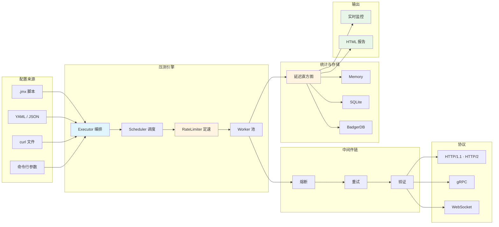
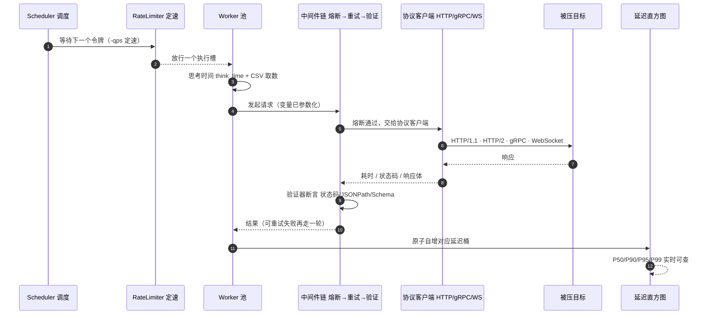
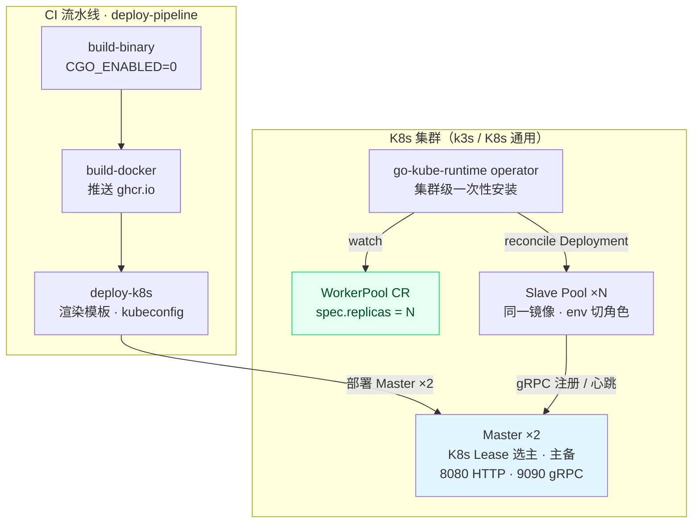

<div align="center">

# ⚡ go-stress

**HTTP / gRPC / WebSocket 一体化压测引擎 — 单条命令起步，单机到 K8s 集群同一套心智**

[](https://github.com/kamalyes/go-stress)
[](https://pkg.go.dev/github.com/kamalyes/go-stress)
[](https://goreportcard.com/report/github.com/kamalyes/go-stress)
[](https://github.com/kamalyes/go-stress/releases)
[](https://github.com/kamalyes/go-stress/actions/workflows/test.yml)
[](https://github.com/kamalyes/go-stress/blob/master/LICENSE)
[](https://github.com/kamalyes/go-stress/stargazers)

</div>

## 🏗️ 架构

配置进来，报告出去，中间是一条可组装的压测流水线；同一引擎既能单机跑 CLI，也能 Master/Slave 分布式扩到 K8s：



### 🔄 一次压测请求的生命周期



## ✨ 核心能力

- **多协议**: HTTP/1.1、HTTP/2、gRPC（含反射与 TLS）、WebSocket
- **负载形态**: 按请求数或按时长（`-duration`）、定速压测（`-qps`）、思考时间（constant / uniform / gaussian）、渐进启动
- **数据驱动**: CSV 数据源，全局共享或每并发独立取数，支持回绕
- **参数化**: 78 个内置变量函数，覆盖随机值、时间戳、哈希、编解码、字符串处理
- **依赖链**: API 之间声明 `depends_on`，自动按序执行并在上游失败时跳过下游
- **响应提取**: JSONPath / 正则 / 响应头 / 表达式，提取结果可用于后续请求
- **响应验证**: 状态码、JSONPath、包含、正则、JSON Schema、响应时间、响应大小等 20 余种
- **JMeter 兼容**: 导入 `.jmx` 脚本，逐项转换并给出有损项清单
- **链路追踪**: 每请求携带 W3C `traceparent`，压测结果可与被压服务日志对齐
- **三种存储**: 内存（最快）、SQLite（SQL 查询）、BadgerDB（高写入、纯 Go）
- **分布式**: Master/Slave 架构，支持区域选择、节点过滤、任务重试，可一键部署到 K8s
- **中间件**: 熔断、重试、验证可插拔

## 🚀 快速开始

**macOS / Linux — 一键安装（无需 Go 环境）**

```bash
curl -fsSL https://raw.githubusercontent.com/kamalyes/go-stress/master/install.sh | sh
```

**Windows** — 从 [Releases](https://github.com/kamalyes/go-stress/releases) 下载 `go-stress-windows-amd64.exe`，或已有 Go 时 `go install github.com/kamalyes/go-stress@latest`

30 秒后见第一份报告 — 先起一个内置测试服务器（HTTP + WebSocket，无需任何外部依赖）：

```bash
# 在项目根目录
go run ./testserver
```

另一个终端，对它压一把：

```bash
# 最简压测：10 并发 × 每并发 100 请求
go-stress -url http://localhost:3000/api/health -c 10 -n 100

# 定速 500 QPS — 测「给定到达率下延迟如何」
go-stress -url http://localhost:3000/api/health -c 50 -n 5000 -qps 500

# 压测计划写成 YAML，纳入版本管理
go-stress -config testserver/test-detail.yaml -no-wait

# WebSocket
go-stress -config testserver/websocket-quick.yaml -no-wait
```

> 压测结束默认保留实时报告服务器供查看 — 脚本与 CI 场景记得加 `-no-wait`

<details>
<summary>环境要求与其他安装方式</summary>

| 项 | 要求 | 说明 |
|:---|:-----|:-----|
| **Go** | 1.26+ | 仅源码安装需要；预编译二进制无任何依赖 |
| **CGO** | 仅 `-storage sqlite` 需要 | `memory` 与 `badger` 是纯 Go 实现，`CGO_ENABLED=0` 下可用 |

**源码构建**

```bash
git clone https://github.com/kamalyes/go-stress.git
cd go-stress
go build -o go-stress .
```

**预编译二进制** — 打 `v*.*.*` 标签自动交叉编译发布，覆盖 linux / darwin / windows / freebsd / openbsd / netbsd 与 amd64 / arm64 / 386 / ppc64le / s390x / mips64 / mips64le

</details>

**📖 [完整入门教程 →](docs/GETTING_STARTED.md)**

## 🎯 场景速览

| 场景 | 一句话理由 | 文档 |
|:-----|:-----------|:-----|
| **定速压测** `-qps` | 不限速时压力随系统响应速度波动，容量规划与 SLO 验证必须固定到达率 | [负载形态](docs/LOAD_PROFILE.md) |
| **思考时间** `think_time` | 闭环负载贴近真实用户行为，与「全速打」的开环负载对同一服务相差一个数量级 | [负载形态](docs/LOAD_PROFILE.md) |
| **CSV 数据驱动** | 一万次请求都打同一账号，服务端的缓存、唯一索引、限流会把结果全面带偏 | [负载形态](docs/LOAD_PROFILE.md) |
| **JMeter 迁移** `.jmx` | 存量脚本直接跑或转原生 YAML，转换报告逐项列明有损项 | [JMeter 导入](docs/JMETER_IMPORT.md) |
| **分布式压测** | 单机打满网卡与 CPU 前，先到调度上限；跨机房按区域调度 Slave | [分布式模式](docs/DISTRIBUTED_MODE.md) |

## 📊 指标口径

| 指标 | 口径 |
|:-----|:-----|
| **总请求数 / 成功 / 失败 / 跳过** | 精确计数，原子累加 |
| **最小 / 最大 / 平均耗时** | 精确值 |
| **P50 / P90 / P95 / P99** | 分桶直方图，相对误差不超过 **0.78%**，且取桶上界因此不会低报 |
| **QPS** | 总请求数 ÷ 总耗时 |
| **秒级时序曲线** | 每秒对直方图做差分采样出该秒的 QPS 与延迟百分位；超长压测自动两两合并窗口翻倍，内存恒定 |

延迟分布用定长直方图而非逐条记录：内存恒为约 70KB 与请求数无关，记录一次只是一条原子自增，代价是百分位带上述有界误差 — 这是主流压测工具的通行取舍

## ☸️ 容器化与 K8s

单镜像多角色（env 切 master / slave），Master 双副本经 K8s Lease 选主形成主备，Slave 压测节点池由 [go-kube-runtime](https://github.com/kamalyes/go-kube-runtime) 的通用 WorkerPool operator 声明式管理 —— `kubectl apply` 一改 `spec.replicas`，秒级伸缩压测节点：



安装 go-kube-runtime operator 后，两条命令拉起全套压测集群：

```bash
export NAMESPACE=stress WORKER_IMAGE=ghcr.io/kamalyes/go-stress:latest
envsubst < deploy/rbac-master.yaml  | kubectl apply -f -
envsubst < deploy/workerpool.yaml   | kubectl apply -f -
```

**完整手册**（operator 前置安装、容器化环境变量全表、CI 流水线接入）→ **[docs/DISTRIBUTED_MODE.md](docs/DISTRIBUTED_MODE.md)**

## 📚 文档导航

| 文档 | 内容 |
|:-----|:-----|
| [快速开始](docs/GETTING_STARTED.md) | 安装、第一个压测、读懂报告 |
| [命令行参考](docs/CLI_REFERENCE.md) | 全部 46 个参数、默认值、常用组合 |
| [配置文件](docs/CONFIG_FILE.md) | YAML / JSON 全部字段与取值 |
| [负载形态](docs/LOAD_PROFILE.md) | 定速、思考时间、渐进启动、CSV 数据驱动 |
| [变量函数](docs/VARIABLES.md) | 78 个内置函数：随机值、时间、加密、字符串 |
| [JMeter 导入](docs/JMETER_IMPORT.md) | `.jmx` 脚本导入、元素映射表、转换报告 |
| [链路追踪](docs/TRACING.md) | 每请求 trace-id、与被压服务日志对齐 |
| [存储适配器](docs/STORAGE_ADAPTERS.md) | memory / sqlite / badger 的取舍 |
| [存储与报告](docs/STORAGE_REPORT.md) | 报告产物、实时监控、指标口径 |
| [分布式模式](docs/DISTRIBUTED_MODE.md) | Master/Slave 架构、节点调度、任务重试、K8s 部署 |
| [集群搭建](docs/CLUSTER_SETUP.md) | 本地/裸机/K8s 三种搭法、runtime 时序流程图、验收清单 |

## 📂 项目结构

```
go-stress/
├── main.go                 命令行入口与参数定义
├── bootstrap/              三种运行模式的启动器（standalone / master / slave）
├── config/                 配置模型、YAML/JSON 加载、curl 与 .jmx 导入、变量解析
├── executor/               压测引擎：编排、调度、Worker、限速、思考时间、CSV 取数
├── protocol/               协议客户端：HTTP、gRPC（含反射）、WebSocket
├── verify/                 响应验证器注册表与内置实现
├── statistics/             指标采集、延迟直方图、实时服务器、报告生成
├── storage/                存储适配器：memory / sqlite / badger
├── distributed/            Master/Slave 的 gRPC 服务、任务队列、节点池、聚合
├── deploy/                 K8s 部署清单（Master 选主 RBAC、WorkerPool 压测节点池）
├── logger/                 日志封装（基于 go-logger）
├── types/                  跨包共享的类型定义
├── testserver/             内置测试服务器与示例配置
└── docs/                   全部文档
```

## 🤝 贡献

欢迎提交 Issue 和 Pull Request

1. Fork 本仓库
2. 创建特性分支：`git checkout -b feature/amazing-feature`
3. 提交更改：`git commit -m '✨ feat: Add amazing feature'`
4. 推送分支：`git push origin feature/amazing-feature`
5. 开启 Pull Request

提交前请确保 `gofmt -l .` 无输出、`go vet ./...` 与 `go test -race ./...` 通过

<details>
<summary>Git Commit Emoji 规范</summary>

| Emoji | 类型 | 说明 |
|:-----:|------|------|
| ✨ | feat | 新功能 |
| 🐛 | fix | 修复 bug |
| 📝 | docs | 文档更新 |
| ♻️ | refactor | 代码重构 |
| ⚡ | perf | 性能优化 |
| ✅ | test | 测试相关 |
| 🔧 | chore | 配置/构建 |
| 🚀 | deploy | 部署发布 |
| 🔒 | security | 安全修复 |
| 🔥 | remove | 删除代码 |
| 📦 | deps | 依赖变更 |

**示例**: `git commit -m "✨ feat(executor): 新增中间件链支持"`

</details>

## 📄 许可证

[Apache License 2.0](LICENSE)
