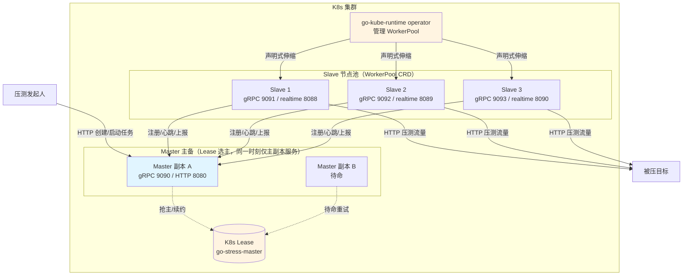
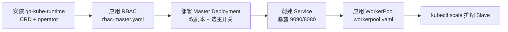
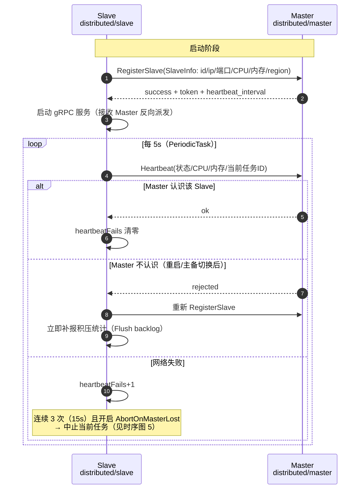
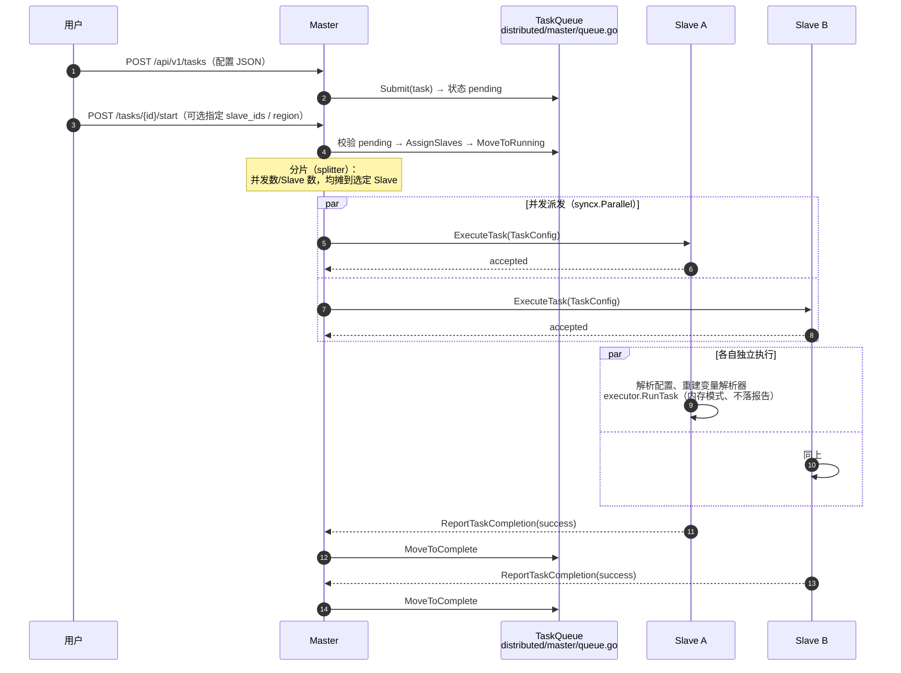
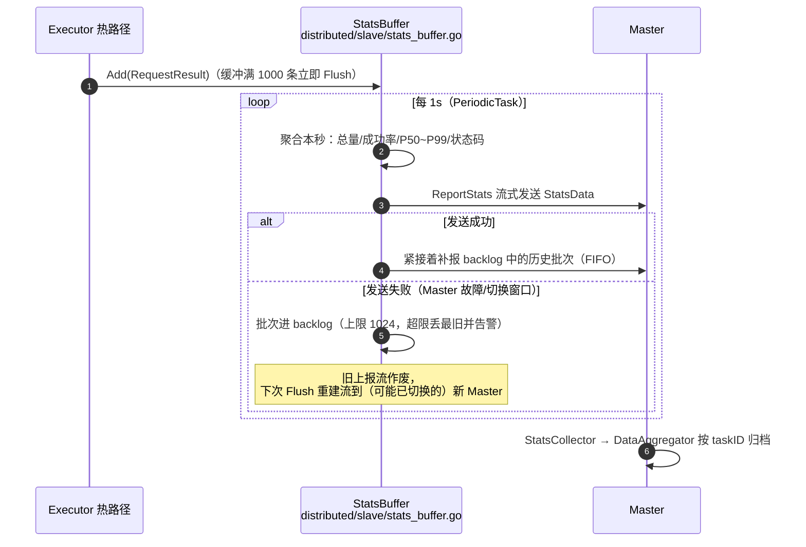
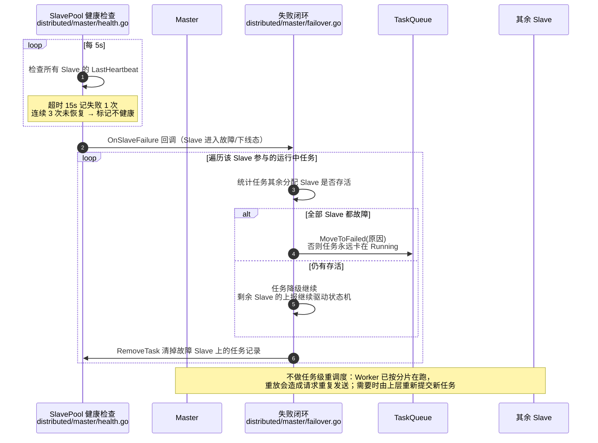
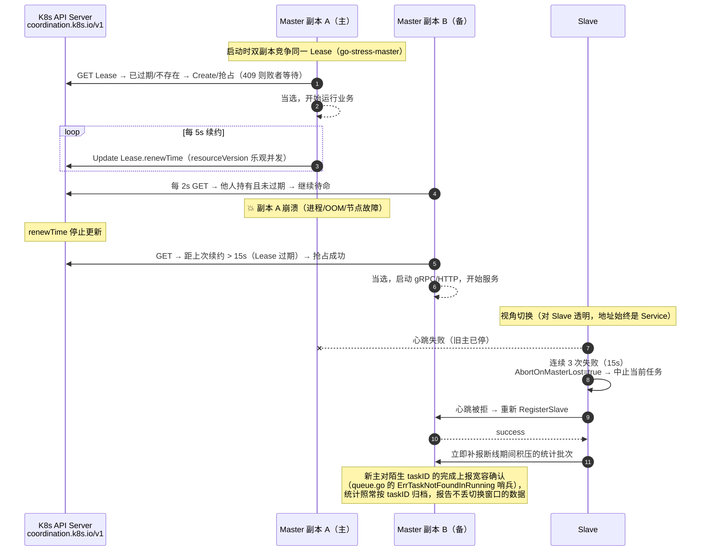

# 集群环境搭建手册

从零搭起一套可运行的 go-stress 分布式压测集群：本地多进程 → 裸机多机 → K8s 多副本高可用，并配齐各环节的 runtime 时序流程图

- 日常用法、Slave 选择策略、HTTP API 详见 [分布式压测](DISTRIBUTED_MODE.md)
- 本文聚焦**怎么搭**与**运行时到底发生了什么**

## 🗺️ 拓扑总览



裸机部署时去掉 K8s 相关部分：Master 单进程，Slave 分布在各台机器，地址直连不走 Service

## 🧪 方式一：本地一键脚本（最快）

仓库自带 PowerShell 脚本，一键拉起 1 个 Master + 3 个 Slave 的本机集群：

```powershell
.\test-distributed.ps1
```

脚本行为：

1. 清理旧进程、`go build`
2. 启动 Master（gRPC `:9090`，HTTP 管理 `:8080`）
3. 启动 3 个 Slave（gRPC `9091~9093`，实时报告 `8088~8090`，区域 `zone-a/b/c`）
4. 自动打开浏览器 `http://localhost:8080`

想改规模改脚本头部的变量即可：

```powershell
$SLAVE_COUNT = 3          # Slave 数量
$SLAVE_BASE_PORT = 9091   # Slave gRPC 起始端口
```

验证：管理界面能看到 3 个 `Active` 状态的 Slave 即搭建成功；再起一个本地靶机跑一轮

```powershell
go run ./testserver        # 靶机 http://localhost:3000
```

然后在 `http://localhost:8080` 创建任务（配置里 `url` 指向 `http://localhost:3000/api/health`），点击启动，任务应被均分到 3 个 Slave 执行

## 🖥️ 方式二：裸机多机手动部署

### 1. 分发二进制

每台机器放一份编译产物（Slave 机器不需要压测配置文件）：

```bash
CGO_ENABLED=0 go build -o go-stress .
scp go-stress user@slave-host:~/
```

### 2. 启动 Master（中心机房任选一台）

```bash
go-stress -mode master -grpc-port 9090 -http-port 8080
```

| 参数 | 说明 |
|:-----|:-----|
| `-grpc-port 9090` | Slave 注册/心跳/上报走这里 |
| `-http-port 8080` | Web 管理界面与 REST API |

### 3. 各机器启动 Slave

```bash
# 每台 Slave 机器上
go-stress -mode slave \
  -master master-host:9090 \
  -region beijing \
  -slave-id slave-bj-01
```

| 参数 | 说明 |
|:-----|:-----|
| `-master` | Master 地址，必填 |
| `-region` | 区域标签，可按区域调度任务 |
| `-slave-id` | 不填自动生成；**固定 ID 更推荐**——重连能顶掉 Master 上的旧条目 |
| `-realtime-port` | 实时报告端口，不填自动在 8088~8187 中选 |

生产建议：Slave 由 systemd 托管，`Restart=always` 让机器重启后自动归队

### 4. 防火墙放行

Master 机器开 `9090`/`8080`，Slave 机器开 Slave 的 gRPC 端口（Master 反向派发任务用）与实时报告端口

## ☸️ 方式三：K8s / k3s 高可用部署（多主多副本）

这是完整的高可用形态：Master 双副本经 Lease 选主形成主备，Slave 池由 operator 声明式管理



### 1. 安装 go-kube-runtime（一次性）

提供 WorkerPool CRD 与 operator，兼容 k3s / K8s 任意 CNCF 发行版：

```bash
git clone https://github.com/kamalyes/go-kube-runtime && cd go-kube-runtime/operator
NAMESPACE=stress \
OPERATOR_IMAGE=ghcr.io/kamalyes/go-kube-runtime-operator:latest \
WORKER_IMAGE=ghcr.io/kamalyes/go-stress:latest \
  scripts/apply.sh
```

### 2. Master 选主 RBAC

```bash
export NAMESPACE=stress
envsubst < deploy/rbac-master.yaml | kubectl apply -f -
```

权限收窄到 `go-stress-master` 这一个 Lease（`get/update/create`）；用 `GO_STRESS_LEASE_NAME` 覆盖 Lease 名时需同步改 `resourceNames`

### 3. Master Deployment（双副本 + Service）

示例清单（生产环境推荐经 [deploy-pipeline](https://github.com/kamalyes/deploy-pipeline) 渲染，见 [DISTRIBUTED_MODE.md 的 CI 接入](DISTRIBUTED_MODE.md#ci-接入deploy-pipeline)）：

```yaml
apiVersion: apps/v1
kind: Deployment
metadata:
  name: go-stress-master
  namespace: stress
spec:
  replicas: 2                      # 双副本，配合选主形成主备
  selector:
    matchLabels: { app: go-stress-master }
  template:
    metadata:
      labels: { app: go-stress-master }
    spec:
      serviceAccountName: go-stress-master
      containers:
        - name: master
          image: ghcr.io/kamalyes/go-stress:latest
          env:
            - name: GO_STRESS_MODE
              value: master
            - name: GO_STRESS_LEADER_ELECT   # 开启 Lease 选主
              value: "true"
          ports:
            - { name: grpc,  containerPort: 9090 }
            - { name: http,  containerPort: 8080 }
---
apiVersion: v1
kind: Service
metadata:
  name: go-stress                   # Slave 经此注册，主备切换对 Slave 透明
  namespace: stress
spec:
  selector: { app: go-stress-master }
  ports:
    - { name: grpc, port: 9090, targetPort: grpc }
    - { name: http, port: 8080, targetPort: http }
```

两个副本都会启动，但只有抢到 Lease 的那个真正运行业务；备副本每 2s 重试抢主，主副本失联后**最长 15s（Lease 有效期）** 内完成切换

### 4. Slave 节点池（WorkerPool CRD）

```bash
export NAMESPACE=stress WORKER_IMAGE=ghcr.io/kamalyes/go-stress:latest
envsubst < deploy/workerpool.yaml | kubectl apply -f -
```

扩缩压测节点只是一条命令：

```bash
kubectl -n stress scale workerpool go-stress-slaves --replicas=10
```

关键环境变量（完整清单见 [DISTRIBUTED_MODE.md 容器化环境变量](DISTRIBUTED_MODE.md#容器化环境变量)）：

| 环境变量 | 建议值 | 说明 |
|:---------|:-------|:-----|
| `GO_STRESS_MASTER_ADDR` | `go-stress.stress.svc:9090` | 经 Service 注册，主备切换无需改配置 |
| `GO_STRESS_ABORT_ON_MASTER_LOST` | `"true"` | Master 失联 15s 即中止当前任务，主备切换止损（见下文时序图 5） |
| `GO_STRESS_WORKER_ID` | 从 `POD_NAME` 派生（默认） | 多 Master 副本的 Snowflake 任务 ID 不冲突 |

### 5. 验证

```bash
# 应只有一个副本在监听（主副本），另一个待命
kubectl -n stress logs deploy/go-stress-master --tail=20 | Select-String "Leader"

# Slave 全部注册成功
kubectl -n stress logs -l pool.kamalyes.io/name=go-stress-slaves --tail=20 | Select-String "Registered"
```

浏览器访问 `http://<任意可达地址>:8080`，看到 Slave 列表即完成

## ⏱️ Runtime 时序流程图

以下时序图与源码一一对应，标注了关键源文件

### 1. Slave 注册与心跳



### 2. 任务分发与执行



要点：

- Slave 的任务 context 与 Slave 生命周期 context 严格分离，`Stop` 不会误杀、任务取消也不会带崩进程（`slave.go` 的 `taskMu` 注释）
- 被停止/中止的任务跳过完成上报，只刷数据——避免在新主上产生"孤儿完成"告警

### 3. 统计上报与断线补报



补报触发点有两个：每次成功发送后捎带补报；重连/重注册成功后立即主动补报一次（不等下一个周期）。断线期间的数据因此**不丢**，只是迟到

### 4. Slave 挂掉的处理闭环



### 5. Master 主备切换（K8s Lease 选主）



选主时序约定（`go-kube-runtime/leaderelection.go`）：

| 参数 | 值 | 说明 |
|:-----|:---|:-----|
| Lease 有效期 | 15s | 过期后备副本可抢占 |
| 续约间隔 | 5s | 有效期的 1/3，瞬时失败仍有补续窗口 |
| 抢主重试 | 2s | 备副本待命轮询间隔 |
| 连续续约失败上限 | 2 次 | 10s < 15s，仍在有效期内，判定可靠 |

失去主身份（续约连续失败/被抢占）时旧主**进程退出**，由 K8s 重新拉起并重新竞争——不在原地重试，因为旧副本的内存态（任务队列/连接池）已不可信

### 6. 数据一致性模型（多主多副本）

| 数据 | 位置 | 主备切换时 |
|:-----|:-----|:-----------|
| 任务状态（pending/running/终态） | Master 内存 | **不迁移**：旧任务在新主无状态记录（无法查询/控制），任务视角以重新发起为准 |
| 实时统计 | Slave 缓冲 + backlog → Master 聚合器 | **不丢**：断线批次缓存在 Slave（上限 1024 批），重连后 FIFO 补报，聚合器按 taskID 自动建档 |
| 压测执行 | Slave Executor | 开启 `GO_STRESS_ABORT_ON_MASTER_LOST` 后跟随 Master 存亡：失联 15s 中止，等新主重新调度（止损，避免孤儿任务裸跑） |

一句话概括：**控制面（任务状态）可丢、数据面（统计）不丢、执行面（任务）可控**。当前版本有意保持控制面无状态以换取部署简单；若业务上不能接受任务状态丢失，需自行扩展 Master（把任务状态接入外部存储），现不内置此能力

## ✅ 验收清单

| # | 检查项 | 通过标准 |
|:-:|:-------|:---------|
| 1 | Slave 注册 | 管理界面看到全部 Slave 且状态 Active |
| 2 | 任务分发 | 启动任务后每个选定 Slave 日志出现 `Executing task`，并发均摊 |
| 3 | 统计上报 | 任务详情/实时报告有数据，QPS ≈ 各 Slave 之和 |
| 4 | Slave 宕机闭环 | `kill` 一个运行中的 Slave，15s 内 Master 日志出现 `Slave marked as unhealthy`；单 Slave 任务转 failed，多 Slave 任务降级继续 |
| 5 | 断线补报 | 重启该 Slave，日志出现 `Stats backlog resent`，总请求数无缺口 |
| 6 | 主备切换（K8s） | `kubectl delete pod` 主副本，15s 内备副本日志出现 `当选 Leader`；Slave 重新注册；补报批次到达新主 |
| 7 | 任务止损 | 主备切换期间旧任务被 Slave 侧中止（`aborting current task`），无孤儿任务继续发压 |

## 相关文档

- [分布式压测](DISTRIBUTED_MODE.md) — 用法、API、Web 界面
- [命令行参考](CLI_REFERENCE.md) — 全部参数
- [go-kube-runtime](https://github.com/kamalyes/go-kube-runtime) — 选主与 WorkerPool operator
